# Log-scale channels, from macrostructure to microstructure: MU case study

Data snapshot: close of **2026-10-01** (MU 1,097.39). Daily bars for 40 large caps
(10y), MU 5-minute (60 sessions) and 1-minute (7 sessions) bars, and the full MU
option chain (22 expiries, 3.49M contracts of open interest). All from Yahoo.
Everything below is reproducible with the scripts in this folder (see bottom).

---

## TL;DR

1. **Yes, the lines can be drawn by a computer.** Rotate a ruler in log space
   until the band holding 70% of wicks is as narrow as possible, and pick the
   anchor by scanning swing lows. Run blind on MU, the algorithm picks the
   **2025-04-07 low** (the same one you drew from) and returns a **591%/yr**
   channel, 39% wide, with R² 0.966. Today's lines: **lower 1,070 · mid 1,261 · upper 1,485**.
2. **Why log scale:** returns compound, so a constant growth rate is a straight line
   in log space. The *parallel* lines come from a moving-average identity: in a
   log-linear trend, an N-day SMA trails price by a **constant** log distance
   b·(N−1)/2. For MU that predicts the 50-day SMA sits 18.8% below the midline;
   the observed average is 16.2%, almost exactly the lower rail (16.4%). **The lower
   line is the 50-day SMA that dip buyers watch, drawn as a straight line.**
3. **Brute-force test: lines are mostly not magic.** Across 40 stocks and about 2,000
   fresh line touches (no look-ahead), rejection rates at lines are 4 pts higher than
   in random paths built from each stock's own returns. But the random-path rate sits
   **inside** the 95% confidence interval on both sides. Most of the "respect" you see
   is what any trending, volatile random walk looks like once you fit lines to it.
4. **Breakouts are partly predictable.** A walk-forward logistic model (trained before
   2021, tested 2021 onward) gets an out-of-sample **AUC of 0.62** and is well
   calibrated. Two things drive it. First, which line is touched: counter-trend lines
   break 62% of the time, with-trend lines 46%. Second, how fast price approaches the
   line, plus volatility expanding (not compressing). High volume at the touch
   slightly favors rejection (absorption).
5. **Microstructure right now (MU):** your channel has a deadline. The lower line rises
   0.77%/day, so **if MU goes flat it breaks the channel in about 3 trading days**,
   without any selloff. Options map:
   - Biggest dealer-gamma strike is **1,100**, right at spot; the next are 1,150, 1,200 and 1,300 (call open-interest wall).
   - Gamma flip is about **1,011** (classic sign convention), just under the lower line.
   - Put support is at 1,000.
   - Price just pushed above the 60-session value-area high (1,077).
   - Breakout up needs acceptance above 1,100 → 1,150. Breakdown means losing 1,070 and then 1,011, where hedging flips from dampening moves to amplifying them.

---

## 1. Computing the lines (`channels.py`)

Model: `log P(t) = a + b·t + e(t)`, with t as the trading-bar index (what a
TradingView log chart uses on its x-axis).

* **Slope:** choose b to minimise `q85(log high − b·t) − q15(log low − b·t)`. That
  is the narrowest strip containing 70% of the highs and lows. Using quantiles instead
  of max/min is what lets the June-2026 blow-off poke through, as it does in your
  drawing.
* **Lines:** upper and lower are those two quantiles; the mid is halfway.
* **Anchor:** test every 10-bar swing low 120–750 bars back. Score =
  `R² · log(length) · total trend move / width`, and keep the best.
* The tolerance `q` sets the style: 3% gives a 93% wide envelope, **15% gives 39%
  (closest to your picture)**, 25% gives 26%.

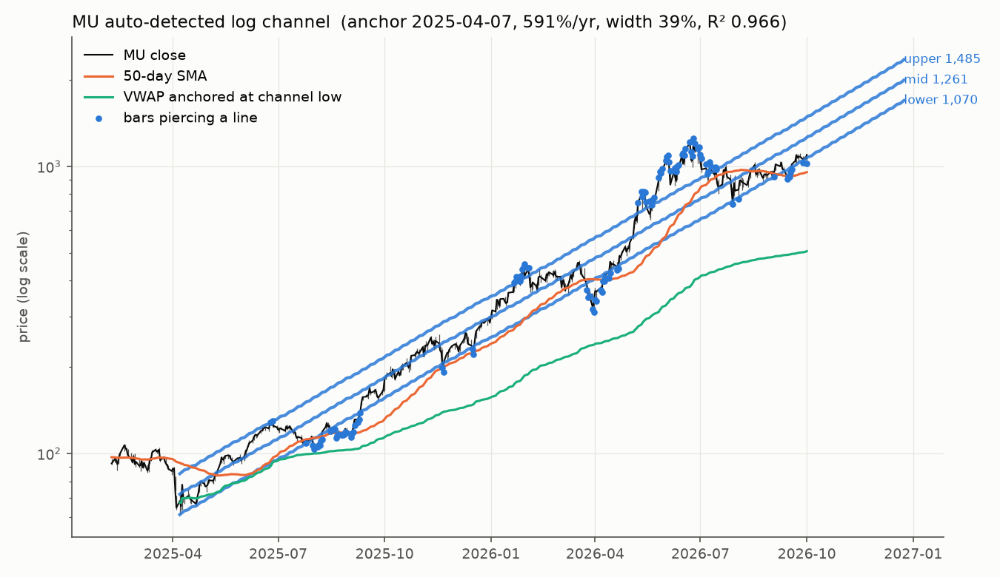

Channel residual dynamics: AR(1) φ = 0.960 → **mean-reversion half-life about 17
trading days**. In theory the band acts like a spring (an Ornstein–Uhlenbeck
process around the trend). Section 3 tests whether that is real or just a
side effect of fitting the line.

## 2. Why price looks like it respects log channels: the thesis

| Mechanism | Prediction | Evidence here |
|---|---|---|
| Returns compound, so constant growth is linear in log | Straight trend line in log space only | R² 0.966 over 374 bars |
| **SMA-lag identity**: SMA_N trails a log-linear trend by b(N−1)/2 | 20/50/100-day SMAs are *parallel lines* at fixed offsets | Predicted −7.3% / −18.8% / −38.0% vs mid; observed −6.2% / −16.2% / −33.7%. Lower rail at −16.4% ≈ 50-day SMA |
| Dip buyers, CTAs and vol-targeters size in *percent* of NAV / ATR | Pullbacks are a constant % deep, so the channel width stays constant in log space | Width is stable while price went ×17 |
| Option strikes cluster at *% out of the money*, and as price rises the open interest gets rolled to higher strikes | The gamma "ceiling" travels with price at a roughly constant % above it | Call-OI strikes now sit 0–18% above spot (1,100/1,150/1,200/1,300) |
| Anchored VWAP from the low | A support level | **Rejected for this trend**: the AVWAP rises far more slowly and sits about 50% under price. It is not the rail |

**What breaks the channel:** the slope has to keep being paid for. Any month
where price grows slower than the slope (here 0.77%/day, about 17%/month)
mechanically walks price down through the lower line. That's why channels this
steep end in *time* (sideways), not necessarily in crashes. The 50-day SMA
(954 today) now sits **below** the lower line (1,070), because price has gone
sideways since June. The flow anchor has already separated from the geometric line.

## 3. Brute force: do lines matter beyond chance? (`backtest.py`)

Setup:

* **Universe and channels:** 40 stocks/ETFs, 10 years. Rolling channels (126 and 252 bars), refit every 5 bars on past data only, kept when R² ≥ 0.75.
* **Event:** a fresh touch, meaning a wick reaches a line after 5 bars without touching it.
* **Outcome (within 20 bars):** *break* = close 0.5 half-widths beyond the line; *reject* = close 0.5 half-widths back inside. The two thresholds are symmetric, so a coin-flip world gives about 50/50.
* **Null:** 12 stationary block-bootstrap paths per stock (mean block 10 days). This keeps drift, fat tails and volatility clustering but destroys any memory of price levels. The identical pipeline runs on the fake paths.

| | real reject | 95% CI (month-clustered) | null reject |
|---|---|---|---|
| lower-line touch (n = 1,194) | 39.2% | 34.9–43.4% | 35.6% |
| upper-line touch (n = 811) | 46.7% | 42.3–51.1% | 42.6% |

The real rate is higher on both sides, but neither difference is statistically
significant. In short: the channel helps you describe the trend, but it is not
yet an edge on its own.

Options-calendar tests (2018 onward, cross-sectional means per date, 105 monthly expiries):

* **Pinning:** distance of the opex-Friday close to the nearest strike = 0.247 strike units vs 0.249 on other Fridays (±0.002). **No measurable pin at the daily close.**
* **Vanna/charm drift:** week into opex −8 bp vs week after +51 bp (difference −60 ± 52 bp); realized volatility after opex / before = 1.06 vs 1.05 on other weeks. **Not significant.** The folklore exists, but you can't detect it on daily closes; it has to be measured intraday.

## 4. Predicting breakouts

Features at the touch:

* trend quality: R², slope (signed to the touched side)
* channel width in volatility units
* volatility ratio (10-day vs 60-day realized vol)
* 5-day vs 50-day volume
* 5-day close-location-value delta (a crude daily buy-vs-sell proxy)
* number of prior touches
* approach speed
* range vs ATR, gap size, extension above the 20-day SMA

One feature was removed: how far the touch bar closed through the line. Including it
pushes AUC to 0.71, but it is partly mechanical (that bar is already part way to the
break threshold).

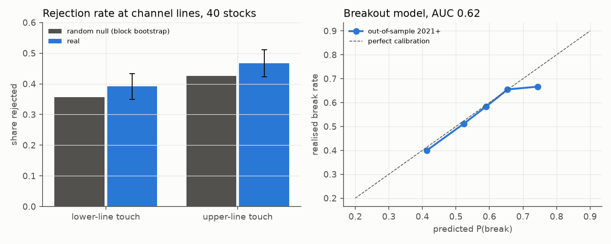

* Out-of-sample (2021 onward, n = 1,289): AUC **0.62**, calibrated. Predicted 41% → realised 40%; predicted 74% → realised 67%.
* **Which line, relative to trend:** the biggest single driver. Counter-trend lines (the lower line of an uptrend) break 62% of the time, with-trend lines 46%. Strong trends fail by *losing support*, not by pausing at the ceiling.
* **Approach speed:** fast approaches break more often, 62% in the top third vs 51% in the bottom third.
* **Volatility expanding:** helps (coefficient +0.39). The "squeeze" story, a compressed range before a breakout, does not show up at this horizon.
* **Volume at the touch:** high volume slightly favours rejection (−0.27). That is the absorption signature: big volume at the line without progress.

## 4b. Level hopping: do the lines predict which level is hit next? (`level_hits.py`)

Starting point: 351 moments in uptrend channels (39 stocks) where price sat at the lower line, like MU now. The benchmark is a driftless random walk with trailing 20-day realized vol; its barrier distances include the drift of the rising lines.

| Target within 20 bars | Hit | Random walk | Excess (95% CI, month-clustered) |
|---|---|---|---|
| Mid line | 23% | 24% | −1 pt (−7, +6) |
| Upper line | 6% | 7% | −1 pt (−4, +3) |
| Half a band below | 77% | 84% | −7 pt (−13, −1) |
| Next level down | 52% | 50% | +2 pt (−5, +9) |

**The levels carry almost no information beyond volatility.** Jumps between levels are just volatility measured in band-widths. For options, this moves the edge from *which level* to *realized vs implied volatility* and pin-vs-trend behaviour, where dealer gamma positioning is the candidate predictor (see §7).

## 4c. MSFT's two big up-weeks: what free data says (`week_forensics.py`)

There is no free historical open-interest data, so positioning *then* is inferred from the calendar, the VIX complex and price/volume. The current chain (2026-10-01) is a real snapshot.

| | Week of 13 Apr 2026 | Week of 27 Jul 2026 |
|---|---|---|
| MSFT / QQQ | +13.1% / +6.0% | +19.7% / +0.6% |
| Trigger | **Monthly opex week** (17 Apr), no event | **Earnings** (29 Jul after close): +11.4% gap, 3.3× volume |
| Shape | Five steady up days, small gaps, 1.0–1.4× volume (hedge unwinding) | Gap, then follow-through (+3.0%, +4.8% the next days) |
| MSFT drawdown before | −32% from high | −30% from high |
| VIX | 31 → 19 in prior 3 weeks, 17.5 by Friday | 18.6 → 16.0 |
| Read | Vanna/charm rally into opex: after the March shock, puts and hedges are crushed by falling IV and time, and dealers buy back short hedges. MSFT, the most washed-out mega-cap, rebounds most | Short squeeze after an under-owned print: low expectations, gap through the walls, dealers chase calls; IV crush releases put hedges |

Common pattern: a ~30% drawdown (under-owned, hedged), vol falling, and a forced-flow date (opex or earnings).

**Now (2026-10-01, MSFT 512.80):**

* **The setup is not the same.**
  - MSFT is up 38% from its June low, so it is not washed out.
  - VIX is 16 in contango, so there is little vol left to crush (little vanna fuel).
  - Positioning is already call-heavy (put/call OI 0.54).
* **The calendar does rhyme with July.** Oct 16 opex holds most of the near-term gamma: 62k 550 calls, 40k 510 calls, about $518M of the ~$1.16B per 1% across expiries ≤60d under the classic sign. Earnings are **Oct 28 after close**. After the 16th the pin falls away right before the event, so the **week of Oct 26 is the candidate "elevator" week**.
* **The upside case needs more than the options price.** Implied earnings move is ±6.0% (from the Oct 23 vs Oct 30 IV jump). Getting to the upper line (~585–600) is roughly a 2–2.5σ event move. MSFT moved ≥10% in two of its last four reports.

## 4d. What "frees" the market: S&P 500 dealer gamma (`release.py`)

Data: SqueezeMetrics' free daily S&P dealer-gamma estimate (GEX, from 2011) and DIX, plus the S&P 500 and the VIX complex from 1990. Outcome: the next 10-day S&P move. An "elevator" leg is a top-decile up move (base rate 10%).

**Calendar and VIX triggers alone barely matter.** Lift on P(elevator):

| Trigger | Lift |
|---|---|
| Day after monthly opex | 1.07× |
| Day after quarterly opex | 1.03× |
| VIX settlement | 0.82× |
| VIX crush | 1.13× |
| Term structure out of backwardation | 1.41× (n = 71, CI includes 1) |
| 2–3 triggers stacked | ~1.1× |

The first month of a quarter has the best 10-day returns (47–62 bp vs 8–24 bp), which fits earnings season and buyback windows reopening. That is about 2σ.

**Dealer gamma is the variable that matters.** GEX is ranked against its trailing year:

| GEX quintile | P(elevator) | P(top-decile move either way) | next-10d realized vol |
|---|---|---|---|
| 0 (lowest) | **24%** | 24% | 20.9% |
| 1 | 13% | 12% | 14.7% |
| 2 | 8% | 6% | 12.5% |
| 3 | 3% | 5% | 11.1% |
| 4 (highest) | **2%** | 3% | 9.8% |
| GEX < 0 | **33%** | 33% | 26.9% |

It survives three checks:

* **Controlling for VIX.** Within high-VIX days, P(elevator) runs 29% → 5% from low to high GEX. In low-VIX markets it is ~0 whatever GEX does: the index cannot sprint without vol.
* **Non-overlapping samples:** 22.5% → 4%.
* **2020 onward:** 28% → 3%.

For options, realized minus VIX is −2.4 vol pts at low GEX vs −7.9 at high GEX (high-VIX days). Index options are much closer to fairly priced when gamma is low. Selling vol earns most when gamma is high.

**The 2026 legs:**

* **April:**
  - GEX fell negative from the Mar 18 VIX settlement through the quarterly opex. It bottomed at **−$7.2B on Mar 27 (0th percentile)**, the low.
  - The rally began at that trough.
  - Gamma rebuilt as price rose, reaching the 99th percentile on Apr 16–17 opex, and the leg stalled.
* **July/August:**
  - GEX dropped to the 10th–20th percentile on Jul 23–28, after Jul 20 opex and around the Jul 22 VIX settlement.
  - The leg ran through earnings and stalled once GEX hit the 99th percentile on Aug 5.

**The mechanism:** a leg starts when dealer gamma is low or negative (price is "free") and ends when the rally rebuilds gamma to an extreme (price is pinned).

**Now (Oct 1):** GEX $5.6B, 44th percentile, down from $9.6B at Sep 18 opex. VIX is 16.4, mid tercile. The historical P(elevator) for this cell is ~4%. Not freed. Watch for GEX dropping into the bottom quintile around Oct 16 opex, the Oct 21 VIX settlement and earnings season.

## 4e. Earnings: does pre-event positioning decide how a surprise is priced? (`earnings.py`)

**Events:** 690 earnings reactions across 38 stocks, 2017–2026. Each is the highest-volume day of its quarter with ≥ 2.5× volume and a gap ≥ 2σ.

**What is measured:** each reaction is split into the day-0 move and a market-adjusted drift over days 1–10, signed in the day-0 direction:
* **D10 > 0** means under-priced on day 0: it kept going.
* **D10 < 0** means over-priced: it faded.

Overall: +50 bp, with 53% of reactions continuing.

| Positioning proxy | Result |
|---|---|
| **Surprise vs prior 40-day trend** (crowding proxy) | **Against a big trend** (beat after a drawdown, miss after a run-up): **+175 bp, 62% continue** [CI +44, +300]. **With a big trend:** −7 bp, 49%. Same direction under looser and stricter detectors, but the size is unstable (+46 to +131 bp) and the CI often includes zero. Strongest for the biggest surprises |
| Day-0 close location | Day 0 closing weak relative to the surprise → more later drift (regression t = −2.4). The day-0 under-reaction gets finished over the following week. Not robust to the detector threshold |
| Gap faded intraday | Gap 100–150% of the day's move: +128 bp continuation. Gap faded by more than half: −93 bp (reversal) |
| Days to monthly opex | **No effect** (+44 to +64 bp in every bucket) |
| S&P dealer gamma | Weak, and opposite to the index result (t = 1.5) |

**Reading:** your thesis survives at the one thing price data can see, how crowded the stock was going in.
* **Under-owned + surprise:** repricing is slow. Shorts and hedges unwind, and underweight holders chase for days. MSFT in July is the example: −30% drawdown, beat, +22% over five days.
* **Crowded + surprise:** it is priced on day 0 or sold on the news.

The options-specific parts cannot be tested with free data: implied move vs actual, call/put OI concentration at the strikes the gap jumps through, skew, and dealer gamma by strike. Testing them needs per-stock historical chains: ORATS / Cboe end-of-day, or start snapshotting chains before each report.

## 4f. A tradable rule: gamma release + vol crush (`strategy.py`)

**Rules** (fixed in advance; S&P 500 index, GEX from SqueezeMetrics):

* **ARMED:** GEX percentile ≤ 5% at some point in the last 15 days.
* **IGNITION:** VIX ≥ 25% below its 10-day max, first such day while armed.
* **ENTRY:** next day's close.
* **EXIT:** GEX percentile ≥ 95% (pinned) or 20 days.

Parameters were picked on 2012–2018 only, from a 72-point grid (`arm` × `k` × `pin` × `maxhold`), and tested untouched on 2019–2026.

| | Trades | Hit | S&P per trade | Same-length random hold | 30-day ATM call: mean / median / hit | Call vs random entries |
|---|---|---|---|---|---|---|
| In 2012–18 | 19 | 68% | +1.0% | +0.6% | +6% / +15% / 58% | 87th percentile |
| **Out 2019–26** | **15** | **73%** | **+2.9%** | +1.0% | **+17% / +0.5% / 53%** | 84th percentile |

**How robust it is:**

* Out of sample, 81% of the 72 grid configurations beat the same-length random hold (67% in sample).
* The `k = 0.25` (deep VIX crush) rows are a plateau out of sample: excess +0.2% to +1.9% in all 18 configurations.
* **In sample the same plateau averaged ~0**, so the edge is stronger in the 2019–2026 V-shaped-recovery regime and is not proven stable.
* Call returns are lumpy: 2020-03 +96%, 2025-04 +256%, but 2025-03-18 −104% (armed too early, before the April crash).
* Neither period clears the 95th percentile against random-entry calls.
* About 2.4 signals a year.
* IV is set to VIX; real ATM IV usually sits a bit below VIX, so the call numbers are conservative.

**Now (Oct 1):** GEX percentile 0.44 (15-day minimum 0.22). **Not armed.**

## 4g. Has the options market changed too much for old data? (`era_check.py`)

**What the sources say:**

* Commissions went to zero in Oct 2019.
* Retail's share of Cboe volume jumped from 35% to 47% in March 2020, and retail is ~25% of all US option contracts.
* SPX gained expiries every weekday in 2022. 0DTE went from ~20% of SPX volume in 2020 to 59% in 2025, and ~63% in early 2026; retail is 50–60% of it.
* Research on whether 0DTE positioning dampens or amplifies index vol is mixed.
* The data itself has a hole: **SqueezeMetrics-style GEX is built from end-of-day open interest, so it cannot see 0DTE positions.**

| Era | corr(GEX pct, next-10d RV) | P(elevator): lowest → highest GEX quintile |
|---|---|---|
| 2012 – 2019Q3 | −0.48 | 20% → 1% |
| 2019Q4 – 2022-05 (zero commission, retail boom) | −0.41 | 32% → 3% |
| 2022-05 → now (0DTE) | −0.48 | 25% → 2% |

**The core gamma → realized vol / up-leg relationship did not break.** It is equally strong in every era, even though GEX is blind to 0DTE. Multi-day open-interest gamma still drives multi-day legs.

The strategy is different. The edge from the VIX crush (`k = 0.25`) grows over time: mean excess −0.01% → +0.53% → +1.49% per trade. But the 0DTE era has only 5 trades (4 wins, calls +64% median), far too few to fit on. So old data is kept for the *relationship* and weighted toward recent eras for *expectations*. Parameters are never refit on the 0DTE era alone.

## 4h. Forecasting the gamma path from today (`forecast.py`)

**Setup:** today (Oct 1) is GEX pct 0.44, VIX 16.4, VIX/VIX3M 0.88, DIX pct 0.81, SPX at its 50-day average, 9 days after opex. I took the 80 closest historical days (de-clustered, 2012–2026) and tracked the next 30 trading days.

| | Analogs of today | Random day |
|---|---|---|
| GEX reaches bottom quintile within 30d | 66% (median **5 days**, IQR 2–13) | 72% |
| SPX on the way there | median **−1.1%**, 83% negative | |
| An up-leg starts within 30d | 60% (start day median **11**, IQR 4–18) | 64% |
| ...if GEX hit the bottom quintile first | 68% | |
| SPX 30d | median +3.0%, 71% up | +2.1%, 70% up |

**Opex cycle:** GEX percentile builds into monthly opex (0.52 → 0.63) and drops about 17 points on expiry day (0.46). The 0DTE era looks the same.

**Confirmations, measured on their own:**

* **DIX × GEX.** P(up-leg in the next 10 days), normally 10%:
  - mid GEX with DIX > 80th pct (**today's cell**): **15%** (n = 444)
  - mid GEX with DIX < 50th pct: 6%
  - low GEX: 22–26% for any DIX
* **Midterm-year Q4.** +5.0% mean vs +2.9% in other years since 1970, but the same 79% hit rate (n = 14; 2018 was −15%). Not a real edge.

**Reading:** today's state does **not** raise the odds of a leg beyond normal. The way a leg usually starts from here is a small dip (≈1%) that knocks gamma into the bottom quintile within about 1–2 weeks. Typical timing is Oct 7–27, centred on Oct 16 opex. The leg follows after that. High DIX (dark-pool buying) is the one live tilt in favour.

## 4i. Entry ladder: the earliest point where odds tilt (`ladder.py`)

Each rung is a condition, from today's state to the full signal. Events are the first day it turns on, at least 10 days apart. Outcomes are over the next 20 trading days.

| Rung | P(up-leg starts ≤20d), 2012–26 / 2019Q4–26 | Lead to leg (median days) | 60-DTE ATM call | 60-DTE ATM/105% call spread, 2012–26 / 2019Q4–26 |
|---|---|---|---|---|
| any day | 50% / 58% | 7 | −1% | +9.5% / +12.4% |
| R0 mid GEX + DIX > 0.8 (**today**) | 59% / 70% | 5–6 | −3% | +10% / +19% |
| R1 GEX ≤ 0.30 | 61% / 72% | 6 | −3% | +12% / +13% |
| **R2 GEX ≤ 0.30 + DIX > 0.5** | **65% / 79%** | 5 | −1% | **+15% / +16%** |
| R3 GEX ≤ 0.20 | 65% / 73% | 5 | −6% | +13% / +10% |
| R4 GEX ≤ 0.20 + S&P ≥ 2% off its 10-day high | 70% / 74% | 4–5 | −4% | +17% / +11% |
| R5 R4 + DIX > 0.5 | 74% / 83% | 3–5 | −3% | +18% / +11% |
| R7 low GEX + VIX ≥ 25% off its 10-day max | 46% / 52% | 6–8 | **+5% / +10%** | +17% / +21% |

**Reading:**

* P(leg) climbs steadily along the ladder, but **naked calls bought early do not pay more**. Low gamma comes with high VIX, so you buy expensive vol, and the leg arrives with a vol crush.
* The call spread neutralises most of that vega, and R2 onward beats "any day".
* Naked calls only win once the vol crush has happened (R7), which is later.
* **The earliest rung with a clear tilt is R2 (GEX ≤ 30th pct with DIX > 50th):** about 5 days of lead, with a spread rather than a naked call.
* Caveats:
  - Option prices use flat vol at VIX with no skew, so compare rungs with "any day", not with zero.
  - Most rung CIs overlap the base.
  - Events overlap across rungs.

## 4j. Multiverse test: is the gamma result real or a lucky choice? (`multiverse.py`)

**Setup:** 216 specifications, every combination of:

* GEX threshold: 0.1 / 0.2 / 0.3 / 0.4
* DIX filter: none / > 0.5 / > 0.8
* horizon: 10 / 20 / 30 days
* era: 2012+ / 2019Q4+ / 2022-05+
* outcome: excess S&P return / P(up-leg)

**Null:** circularly shift the GEX/DIX series in time (this keeps their persistence and destroys their timing), rerun all 216, and repeat 300×.

| Outcome | Specs positive | Specs p < 0.05 (luck ≈ 5%) |
|---|---|---|
| P(up-leg within H) | **99%** | **91%** |
| Excess S&P return | 65% | 6% (≈ luck) |

* Joint p-value < 0.003 (0 of 300 shifted multiverses matched); 105 of 216 specs survive FDR 10%.
* Lower GEX thresholds and a DIX filter strengthen the effect: P(leg) lift is +26 pts at GEX ≤ 0.1, +26 pts with DIX > 0.8, and +13 pts with no DIX filter.
* It holds in every era (+16 / +19 / +23 pts).

**Conclusion:** low gamma robustly predicts *that a big up-leg starts* (movement). It does **not** predict a higher *average* return, because the downside widens too. This is why structure (spreads) and confirmation (DIX, the VIX crush) matter for direction.

## 4k. Tesla: does the S&P gamma signal carry over? (`single_name.py TSLA`)

**Data:** single-stock gamma history is a premium Alpha Vantage endpoint (not on the connected key) and not free elsewhere. So the predictors stay market-wide (S&P GEX/DIX, VIX), and the target is Tesla's own top-decile 10-day up-leg.

* **No.** Multiverse with TSLA as the target: joint p = 0.74. 0% of 216 specs are significant; P(leg) effect +1 pt on average; excess return is negative in 86% of specs. P(TSLA up-leg) is flat at 9–13% across S&P GEX quintiles in every era.
* **What S&P gamma does do to Tesla:**
  - **Volatility:** next-10d realized vol is 65% at the lowest S&P GEX vs 49% at the highest.
  - **Coupling:** correlation with the S&P is 0.62 at low GEX vs 0.35 at high GEX. Beta falls (1.49 vs 1.98) as correlation rises, and idiosyncratic vol is 57% vs 47%.
  - Low S&P gamma turns Tesla into a market-beta instrument; high gamma leaves it trading on its own story.
* **Ladder:** no rung beats "any day" on P(leg) (38% / 44%).
  - Buying calls into a Tesla-specific dip during low S&P gamma (R4s/R5s) was the worst entry: −25% to −27% vs +12% / +22% any day.
  - Only the vol-crush rung (R7) helps option P&L (spread +33% vs +13% since 2019Q4, n = 27).
  - The "today-like" R0 row looks strong (n = 46), but the multiverse says S&P-gamma conditioning has no robust effect on TSLA, so treat it as noise.
* **Snapshot (Oct 8, TSLA 375):**
  - Earnings **Oct 21**; implied earnings move ±6.0% (ATM IV 39% → 49% across it).
  - Classic gamma flip ≈ 362; largest gamma strikes 372.5–400; the call OI wall is **400** (79k); put OI sits at 350/370; max pain 370 for every expiry through Nov.
  - TSLA is +13.5% over 40 days but 23.5% below its 52-week high (490, Dec 2025).
  - The auto log channel does not fit (R² 0.56, price below its lower line), so there is no channel to trade.

## 4l. Tesla burst check, event by event (`burst_check.py TSLA 2024-01-01`)

**Definitions.** Burst = +5% in 1 day or +9% over 2 days; 36 up-bursts and 35 down-bursts since 2024. A signal "catches" a burst if it first fired 1–10 days before.

**The windows asked about:**

* **Caught:** 2025-04-23 (R6/R7/R4s/R5s, the vol crush after the April crash), 2025-05-27, 2025-11-24, and late Jul 2024.
* **Missed:** 2024-07-01/02 (+15.6%), 2025-09-11/12 (+13%), 2025-10-06 and 2025-10-13. All of them came in calm, high-gamma markets: S&P GEX at the 69th–89th pct, VIX 12–17. These were Tesla-specific catalysts, which market-wide data cannot see.
* **Weak:** 2025-05-12 (only R0).

**Precision vs the base rate** (any day: 47% up / 45% down within 10 days):

| Signal | Fired | Up-burst followed | Down-burst followed |
|---|---|---|---|
| R7 (vol crush) | 11 | **82%** (p = 0.02) | 45% |
| R5s | 12 | 75% (p = 0.05) | 58% |
| R2 | 22 | 64% (p = 0.09) | 50% |
| others | | 42–61% | 36–55% |

Most signals precede down-bursts about as often as up-bursts: they flag Tesla *volatility*, not direction. R7 is the only directional one, and with 10 signals tested its p-value does not survive correction (≈0.2 Bonferroni).

## 4m. Tesla today and three trader observations (`stock_now.py TSLA`, data to Oct 8 2026)

**State:** TSLA 375; S&P GEX pct 0.62, DIX pct 0.91, VIX 15.4. **No ladder rung has fired in 10 days.** This is a calm, mid-to-high-gamma market, the regime where Tesla's bursts came from its own catalysts.

| Observation | Test | Result |
|---|---|---|
| Bursts come going **into** opex week | up-bursts by week vs monthly opex, 2012+ / 2019Q4+ | **Not supported.** Opex week lift 1.03 / 1.04; the week before is 0.87 / 0.83 (fewer); the week after is 1.08 / 1.19 (not significant) |
| Tesla makes its year in 1–2 bursts, often late | top-2 2-day bursts vs the full-year return | **Partly.** The top-2 bursts made ≥ half the gain in 8 of 12 up years, but that is the fat-tail norm for a 50%-vol stock (they sum to +18 to +53% every year, up or down). A Q4 burst is in the top 2 in 5 of 14 years (25% by chance) |
| Catches up with SPY by year end | Q4 relative return when TSLA lagged SPY by >10 pts at Sep 30 | **Supported, small n.** 5 of 5 lagging years beat SPY in Q4 (2012, 16, 18, 19, 24), mean +28.7 pts vs −10.3 in other years (base rate 53%; p ≈ 0.04). 2026 gap: **−30.8 pts** YTD |
| Grind-up like Jul–Aug 2025 → burst | 40 nearest analogs on 40d return, vol, vol ratio, drawdown, trend R², up-day share | The setup really is similar (ret40 +13.5% vs +11.3%; vol ratio 0.60 vs 0.51; drawdown −1.5% vs −1.1%). **But up-burst odds were not higher:** 38% vs 41% base. Down-bursts were rarer: 28% vs 41% |

**Earnings: the dominant burst source.**

* Within ±1 day of 39 reports: up-burst 31%, down-burst 51%, vs 13% for any 3-day window.
* The 11 detected October (Q3) reactions: five ≥ +5% (2014, 2018, 2019, 2021, 2024) and two ≤ −5%.
* Next report **Oct 21**; options price ±6.0% for the event.

**Oct 16 monthly expiry** (36% of ≤45d call OI):

* call OI: 400 (31k), 380, 420
* put OI: 380, 360, 340
* largest gamma strikes: 400, 385
* max pain: 370

The pin releases five days before earnings.

## 4n. Anatomy of Tesla's Q4 catch-ups (`q4_forensics.py TSLA`)

**Catch-up years** (TSLA lagging SPY by > 10 pts at Sep 30): 2012, 2016, 2018, 2019, 2024. For each Q4 up-burst and the year's best 10-day leg relative to SPY, the analysis records:

* calendar position: day of month, opex bucket, Q3 report (published dates), US election
* the burst itself: gap share, follow-through
* Tesla's own state
* the S&P state: GEX, DIX, VIX, term structure

Control group: Q4 bursts in other years. Full table: `out/q4_forensics_TSLA.csv`.

| Year | Main catch-up leg (best 10d vs SPY) | What drove it | S&P GEX pct at the bursts |
|---|---|---|---|
| 2012 | Oct 26 → early Nov, +16.9 | Nov 5 +8.6% on the eve of the Q3 report **and** the election (Nov 6) | 15–20 |
| 2016 | Dec 12 → Dec 23, +13.2 | Q3 report fizzled (−7.4 rel over 10d); a December grind into quad witching instead, no burst | 97 |
| 2018 | Oct 19 (opex day) → Nov 2, +30.3 | Oct 23 +12% two days before the Q3 report, then +8.7% on it | 1–5 (Oct 2018 selloff) |
| 2019 | Oct 11 → Oct 25, +26.3 | Q3 report Oct 24 +16.3%, 97% of it in the gap; Dec 16 burst in Dec opex week | 44–54; Dec 97 |
| 2024 | Dec 3 → Dec 17, +31.1 | Q3 report Oct 24 +19.8%, election Nov 6 +13.8% (+13.5% the next 5d), then a December leg into quad witching | 28–37; Dec 96–99 |

**Common factors:**

1. **The Q3 report is the anchor** in 4 of 5 years. 10-day return vs SPY after the Q3 report:
   - lagging years: +6.3, +13.1, +22.5, +27.8 (2016: −7.4); mean +12.5 pts
   - other years: mean −1.4 (range −35 to +31)
   - This is the earnings-crowding result (§4e): under-owned + surprise → multi-day drift.
2. **December continuation into quad witching** in 3 of 5 years (2016, 2019, 2024). It came at *high* S&P gamma (96–99th pct): a grind, not a burst.
3. **Opex:** the "week after October opex" is over-represented (39% vs 26%) only because that is where the Q3 report falls. With the report removed, there is no opex effect.
4. **S&P gamma is not the common factor.** October bursts came at low-to-mid GEX (1–54th pct); December legs at high GEX.
5. **Tesla was 19–35% below its 52-week high** before every October catch-up burst.
6. **Elections:** bursts at the 2012 and 2024 presidential elections; nothing in 2016 or 2018. n = 2.
7. Catch-up bursts **kept going**: median next-5d +5.1% vs +1.1% for other Q4 bursts. Earnings bursts were made **in the opening gap** (68–97%), so positioning has to be in place before.

**2026 vs the template:**

| Factor | Now | Template |
|---|---|---|
| Gap vs SPY | −30.8 pts | lagging > 10 pts |
| Below 52-week high | −23% | 19–35% below |
| Q3 report | Oct 21 (after close) | week after October opex |
| 40-day return | +14% | only 2019 (+17%) was this high going in; the others were flat or negative, so part of the move may already be priced |
| US midterm | Nov 3 | election bursts in 2012 and 2024 (n = 2) |
| Dec quad witching | Dec 18 | December continuation in 3 of 5 years |

## 4o. Tesla options regime: pre-2020 vs 2020+ (`tsla_eras.py`)

Tesla options changed character around 2020: retail inflows, the Aug 2020 split, heavy short-dated OTM call buying, then the 0DTE era. Every options-related Tesla test is re-run by era.

| Test | pre-2020 | 2020+ |
|---|---|---|
| Up / down bursts per year | 8.1 / 8.8 | **15.1 / 14.4** (vol 50% → 64%) |
| Up-bursts in opex week / week after (lift) | 1.05 / 0.95 | 1.02 / 1.16 (n.s.) |
| **Up-bursts on Monday** (lift, p) | 1.72, p = 0.007 | **1.95, p < 0.001** (2.02 excl. report days) |
| Up-bursts on Friday (weekly expiry) | 0.15 | **0.44** |
| Down-bursts Monday / Friday | 0.83 / 0.92 | 0.89 / 1.04 |
| Q3 report: mean abs move day 0 | 8.1% | 7.1% |
| Q3 report: day 0 ≥ +5% / ≤ −5% | 38% / 25% | 17% / 33% |
| Q3 report: drift after, signed by day 0 | +82 bp | **+706 bp** (n = 6) |
| All reports 2020+ (n = 24): continue in the day-0 direction | | 62.5%, mean +350 bp (t = 1.78, p ≈ 0.15) |
| Grind-up analogs: P(up-burst 10d) vs base | 38% vs 41% (full pool) | **32% vs 52%** (2020+ pool); down 24% vs 49% |
| Q4 catch-up years (lag > 10 at Sep 30) | 2012, 2016, 2018, 2019 (4 of 4 beat SPY) | **2024 only** (+41.3); mild lags 2021 (+20.8) and 2025 (−1.2) |

**Reading:**

* **The Monday effect is the most robust new finding.** It is up-only (Monday down-bursts are below average) and mostly made intraday (median gap share 0.37), so it is not simply weekend-news volatility. Friday up-bursts are suppressed. That fits weekly-expiry mechanics: Friday's expiring short-dated calls pin, and fresh weeklies bought on Monday put dealers short gamma. It replicates in both eras and survives correction for 20 tests.
* The Thursday down-burst excess (1.59) is mostly earnings reactions (8 of 31; 1.35 and p = 0.07 without them).
* Post-2020 reports reprice more slowly (continuation after day 0), consistent with options-driven hedging after the event; n is small.
* The grind-up state is a *low-burst* state in the 2020+ era: fewer bursts both ways.
* Catch-up evidence in the new regime is only 1–2 years.

## 4p. After the leg: topping, consolidation and the gamma "reset" (`reset.py`)

Definitions: leg = top-decile 10-day S&P return (≥ +3.5%); reset = GEX pct ≤ 0.30; consolidation = 20-day range in the bottom 30%. Each pair of numbers below is 2012+ / 2019Q4+.

| Question | Result |
|---|---|
| **Do legs need a reset first?** | **Yes.** 88% / 90% of legs had GEX ≤ 0.30 within the prior 20 days, vs 73% / 71% of random days (p = 0.001 / 0.002) |
| **Gamma ran up with no price** (GEX pct +0.5 from its 7-day low while the S&P 7d is −1% to +2.5%) | P(leg within 20d) **27% vs 44%** (p < 0.001) / 40% vs 51% (p = 0.07). Consolidation 36% vs 30% / 27% vs 19% |
| **Leg ends pinned** (GEX ≥ 0.90 at the leg end) | Next 20d: consolidation **55% vs 30%** / 36% vs 19%; new leg 35% / 36% vs 44% / 51%; shallow dips (median −0.2% / −0.1%); still drifts up (+1.6% / +3.2%). **A pause, not a top** |
| **Leg ends unpinned** (GEX < 0.90) | New leg 46% / 62%; consolidation 19% / 14%; deeper dips (−1.6% / −1.8%) |
| **Gamma built over 10d** (10d mean GEX ≥ 0.70, S&P 10d flat) | Reset within 40d in 80%, median **11 days** (IQR 6–19). When a leg followed, it came **after** a reset 72% / 74% of the time (median 18 / 15 days) |

**Now (Oct 8):**

* A reset happened Sep 28 (GEX 0.30, DIX 0.82; R2 was on that day).
* The S&P then rose only +1.8% to Oct 6 while GEX ran to 0.91. The "gamma ran with no price" signal fired on Oct 2, 5 and 6.
* Today GEX is 0.62 and fading, DIX is 0.91, VIX 15.4 in contango.
* Read: lower odds of a real leg through late October, chop or consolidation more likely. The next reset typically comes ~5–19 days after the build, roughly Oct 13–30, around Oct 16 opex and the Oct 21 VIX settlement. A leg typically follows it.
* High DIX is the one counterweight: in the matching state *with* DIX > 0.8, P(leg) was 47% (n = 17) vs 33% without the filter.

## 4q. Scorecard: calls since Oct 1 vs what happened (`dashboard_data.py`, dashboard "S&P gamma cycle")

Through the Oct 8 close: 6 calls held, 3 held partly, 1 missed, 3 are still open.

* **Held:** S&P had no up-leg from the Oct 1 state; DIX tilt up (S&P +1.3%); MU broke its rising channel line on Oct 2; MU never accepted above 1,100; MSFT stayed in or just above the 510–525 pin zone.
* **Partly:** gamma built into expiry and is fading ahead of Oct 16; MU chopped, a little lower than called (1,036–1,088); MU lost 1,070 but has not reached the 1,011 flip.
* **Missed:** the usual path, "a ~1% dip pushes gamma down within ~5 days". The S&P rose 2% instead, and gamma ran to its 91st percentile. That miss is what triggered the "gamma ran without price" signal in §4p.
* **Not yet:** R2 (56% by Oct 16).

The dashboard (`out/dashboard/index.html` + CSVs) charts the S&P cycle, the gamma and DIX percentiles with the reset and pinned zones, the next-20-day odds by state, the scorecard, and the MU and MSFT tracks.

## 4r. Free and cheap data, tested before paying (`hd_gamma.py`, `finra_dpi.py`, `earnings_implied.py`, `data_checks_fig.py`)

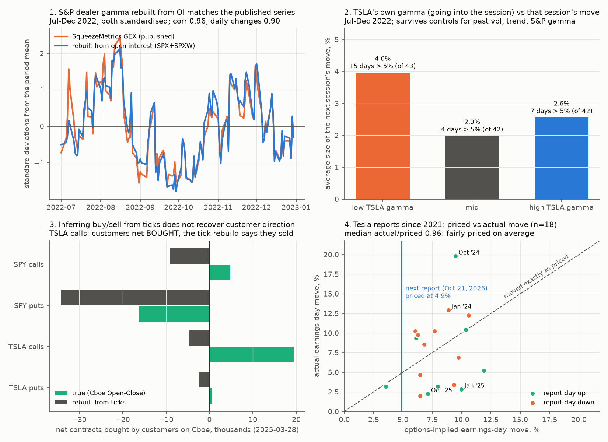

Four sources were tested, each against something known to be true.

1. **Gamma rebuilt from open interest is trustworthy.**
   - **Data:** HistoricalData.net's free sample (TSLA, SPY, SPX/SPXW, Jul–Dec 2022, end-of-day chains with OI and IV), run through the same exposure code as §5.
   - **S&P check:** the rebuilt S&P gamma tracks SqueezeMetrics' published GEX at a correlation of 0.96 (0.90 on daily changes) under the classic dealer convention. The "dealers short both" convention gets −0.34.
   - **Implication:** gamma built from any stock's OI history is a credible input.
2. **TSLA's own gamma matters for the next session's move.**
   - **Evidence:** across the 127 sample days, low TSLA gamma (net, scaled by OI) went with larger next-session moves:
     - **Raw:** rank correlation −0.24.
     - **Controlled:** −0.28 after controlling for the past 5- and 20-day volatility, the past 20-day return and S&P gamma (circularly shifted null p < 0.001).
     - **Below TSLA's own gamma flip:** average move 3.9% vs 2.2%; 16 of the 26 moves larger than 5% came on the 48 days below the flip.
   - **What it does not show:** the 5-day volatility effect fades with the controls (null p = 0.17). Six months is one regime (2022 bear market).
   - **Contrast:** S&P gamma alone barely relates to TSLA's move in the same window (−0.01).
   - **Next step:** this is the result that justifies buying OI history.
3. **Signing trades from tick data fails.**
   - **Data:** Databento OPRA trades with the quote at each print, for 2025-03-28 (TSLA $10.83, SPY $19.99 from the free credit). These were matched series by series to the Cboe Open-Close sample for the same day. Volumes reconcile exactly (Cboe's exchange volume counts both sides).
   - **TSLA calls:** customers net bought 19.4k calls on Cboe; the quote-rule rebuild says they net sold 4.7k (2.1k using only prints at the bid or ask). Volume-weighted sign agreement per series is 55–60%.
   - **SPY:** the rebuild gets the puts' direction but not the calls'.
   - **Why it fails:** about half of TSLA's Cboe volume prints inside the spread (auctions, price improvement, spreads), where the aggressor is invisible.
   - **Implication:** customer direction needs open/close data; tick feeds don't substitute.
4. **Per-stock dark-pool index (FINRA short volume, free, Aug 2018–today) is weak.**
   - **TSLA:** the top-tercile DPI (vs the trailing year) was followed by +5.6% over 20 days vs +2.5% for the bottom tercile, and 60% vs 49% odds of an up-burst within 10 days. Both are only borderline under a circularly shifted null (p = 0.19 and 0.07).
   - **Other names:** MSFT, MU, QQQ and NVDA show no edge; SPY p = 0.07.
   - **Implication:** keep it as a minor tilt at most. DIX works for the index, where aggregation removes noise.
5. **Tesla earnings are priced fairly on average.**
   - **Method:** event variance backed out of the first two post-report expiries in DoltHub's free chains (18 reports 2021–2025).
   - **Average:** implied earnings-day move 8.0%, actual 7.6%, median actual/implied 0.96, with 9 of 18 bigger than priced.
   - **After the report:** when the move beat the price, the next 10 days continued its direction 6 of 9 times vs 4 of 9 otherwise (too few to call).
   - **Next report:** the Oct 21, 2026 report is priced at 4.9% (Oct 9 chains), the cheapest in the set.

**Data plan after these checks:**
* **Buy:** OI history (HistoricalData.net archive, one-time) to extend items 1–2 across 2016–2026.
* **Skip:** tick-level trade data; it only mattered for signing, which fails.
* **Customer direction:** needs the exchange open/close feeds, or the free Cboe samples for spot checks.
* **Not worth buying:** Databento's per-contract OI ("statistics" schema) costs $140–445 per ticker for 2023–2026, more than the archive.

## 4s. Tesla's OWN option gamma, 2021–2026 (`td_pull.py`, `td_gamma.py`, `stock_gamma.py TSLA`)

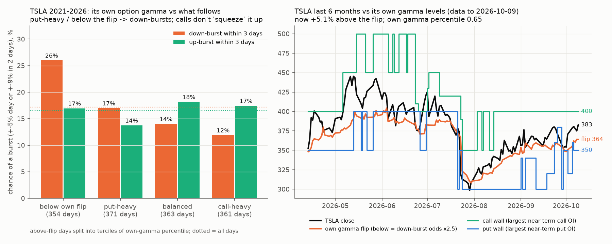

**Data and checks.**
* **Source:** ThetaData Value (one month, $40): end-of-day quotes and open interest for every TSLA option within 120 days of expiry, 2020-01 to 2026-10. All 1,701 trading days are present.
* **Method:** spot is backed out of put-call parity; IV is solved from out-of-the-money mids; gamma uses the same code as §5.
* **Cross-check:** for Jul–Dec 2022, TSLA gamma rebuilt from ThetaData tracks the independent HistoricalData.net sample at 0.99 correlation (flip level 1.00).

**What TSLA's own gamma does.** The analysis covers 1,449 days (2021-01 to 2026-10). A burst is ±5% in a day or ±9% in two days, measured over the next 3 sessions. Controls are past 5- and 20-day volatility, past 20-day return and S&P gamma. P-values come from circularly shifting the gamma series.

* **Below TSLA's own gamma flip:** down-bursts follow 26% of the time vs 14–17% above it. Controlled odds ratio 2.5 (p < 0.001); 2.7 after the §4v fix that reads a missing flip by the sign of net gamma.
  * It holds in both halves: 30% vs 17% in 2021–mid-2023, and 21% vs 13% from mid-2023 to 2026.
  * This is the dealer short-gamma mechanism working on the downside.
* **Put-heavy gamma** (low own-gamma percentile, i.e. near-the-money put gamma outweighs call gamma) doubles down-burst odds (odds ratio 2.1) and roughly halves up-burst odds (0.5).
* **Up-bursts are not a call squeeze in this data.** Call-heavy days have 17% up-burst odds, the same as any day (17%).
  * Tesla's up-bursts come from the calendar and events: Mondays (§4o), reports, and the Q4 catch-up.
  * Their only option-positioning requirement is *not* being put-heavy or below the flip.
* **Next-session move size:** a little larger when own gamma is low (rank correlation −0.10; −0.05 controlled, p = 0.02). Smaller than in the 2022 sample, which was a bear market.
* **Monday effect, tested against the gamma expiring the Friday before:**
  * Monday up-burst odds are 11%, 10% and 12% for little, mid and lots of expiring gamma, so the Friday roll-off does not explain Tesla's Monday bursts.
  * After big Friday expiries, Monday down-bursts were rare (1 of 83 vs 4–8), which fits less gamma pinning.

**Now (Oct 9 close 382.7):**
* **Flip:** TSLA is 5.1% **above** its own gamma flip (364). Own-gamma percentile is 0.65, neither put- nor call-heavy.
* **Walls:** call wall 400, put wall 350.
* **Similar past days** (above the flip, percentile 0.50–0.80; n = 427): up-burst 17.8% vs 16.6% on all days, down-burst 15.5% vs 17.2%. Neutral to slightly favorable.
* **The level that changes the odds is 364:** a close below it historically doubles the chance of a down-burst.
* **Upside:** 400 is the largest near-term call strike, the obvious magnet and cap into the Oct 16 expiry.
* **Timing:** the Oct 21 report is priced at a 4.9% move (§4r).

**Same test on MSFT, MU and NVDA** (`stock_gamma_summary.py`). Bursts here are volatility-scaled, a day beyond 2× the stock's own 60-day volatility, so stocks of different volatility compare fairly.

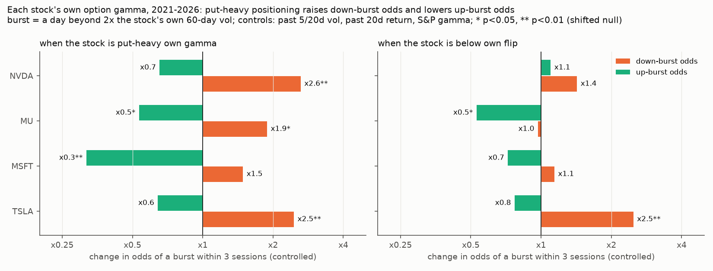

* **The rule that holds across all four stocks:** when a stock's own gamma is **put-heavy** (bottom third of its trailing-year percentile):
  * **Down-bursts:** odds rise 1.5–2.6× (TSLA, NVDA p < 0.01; MU p < 0.05; MSFT p = 0.07).
  * **Up-bursts:** odds fall to 0.3–0.7× (MSFT p < 0.01; MU p < 0.05).
* **Being below the flip** is a strong signal only for TSLA (down-bursts 2.5×). For MU it mostly halves up-bursts.
* **Call-heavy positioning** never raised up-burst odds in any of the four.
* **Monday-after-expiry:** no effect for any of them.

**Where each stands (Oct 9):**

| Stock | Close | Own-gamma percentile | Own flip | Call wall | Put wall | Read |
|---|---|---|---|---|---|---|
| TSLA | 382.7 | 0.65 | 364 (5% below) | 400 | 350 | neutral; 364 is the line to hold |
| MSFT | 535.2 | 0.98 | 442 (17% below) | 550 | 500 | heavily call-weighted, pinned below 550; no put-heavy drag |
| MU | 1,028 | 0.46 | 997 (3% below) | 1,100 | 1,000 | balanced, close to its flip; a close below ~1,000 removes upside odds |
| NVDA | 229.4 | 0.52 | 208 (9% below) | 240 | 200 | balanced, far above its flip |

None of the four is put-heavy today, so none carries the elevated down-burst risk.

**QQQ (Nasdaq-100) gamma, same method.**
* **Below its own flip** (54% of days, since index funds carry heavy hedging puts): big moves in **both** directions.
  * Volatility-scaled up-bursts 9.4% vs 4.9% above the flip; down-bursts 16.0% vs 5.2% (controlled odds 1.65× for down, p = 0.02).
  * This is the same negative-gamma behavior as S&P gamma (§4j).
* **Put-heavy QQQ:** down-burst odds 2.0× (p = 0.01).
* **QQQ gamma adds no consistent signal for the stocks:**
  * Added on top of each stock's own gamma and S&P gamma, only 4 of 16 tests reach p < 0.05, and their signs disagree. For example, TSLA's down-bursts rise 1.6× when QQQ is below its flip, yet fall when QQQ is put-heavy.
  * **Conclusion:** use each stock's own gamma; Nasdaq gamma is for trading QQQ itself.
* **Now:** QQQ closed Oct 9 at 751.2, **on its gamma flip (749)**, with the call wall at 760 and the put wall at 700. A close below ~749 puts the Nasdaq-100 in its negative-gamma regime, where moves get larger both ways.

**SPY gamma, same method, vs SqueezeMetrics.**
* **Agreement:** SPY gamma tracks SqueezeMetrics' S&P gamma at 0.67 over 2021–2026 (0.59–0.92 by year). As percentiles, the inputs the ladder and reset rules use, they correlate at 0.83, and the "reset zone" reading (≤ 0.30) agrees on 85% of days.
* **Why it's lower than the 0.96 for S&P index options in §4r:** SPY options have a different owner base.
* **New information:** put-heavy SPY gamma doubles S&P down-burst odds **after controlling for SqueezeMetrics' gamma** (odds ratio 2.0, p = 0.002). Below-flip adds nothing once SqueezeMetrics is in, and nothing predicts up-bursts.
* **Now:** SPY closed Oct 9 at 778.6, just above its own flip (775). Own-gamma percentile 0.85, not put-heavy. Call wall 800, put wall 740.

## 4t. The Tesla up-bursts, one by one, against Tesla's own options (`burst_gamma.py`, `burst_gamma_fig.py`)

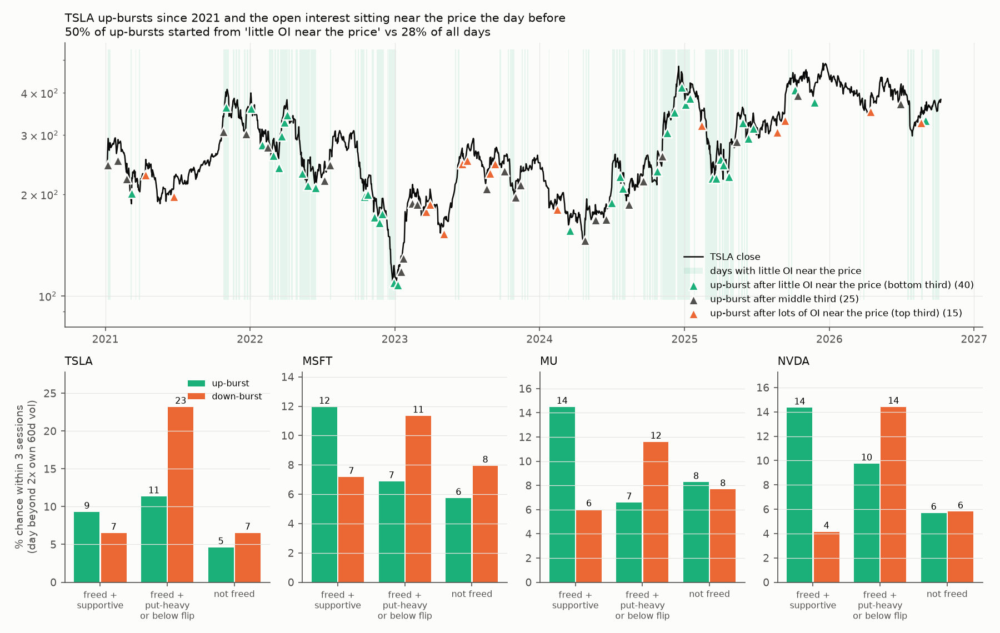

**Method.**
* **Events:** all 80 TSLA up-bursts since 2021 (+5% in a day or +9% in two). Each is matched with the stock's own option positioning the day before; the full table is in `out/burst_gamma_TSLA.csv`.
* **The variable that separates them is how much open interest sits near the price:** the share of all OI within ±5% of spot in expiries up to 45 days, ranked against the trailing year. When it is low, little hedging is tied to the current price, so the price is **"freed"**.

**Results.**
* **Before up-bursts:** 50% of up-bursts started from the bottom third ("freed") vs 28% of all days.
* **Controls:** with recent moves (|5d|, |20d|), past volatility, trend, S&P gamma, own put-heaviness **and 30-day implied vol** controlled, freed days carry 1.9× the up-burst odds for TSLA (p = 0.003).
  * MSFT 3.6× (p = 0.02) and NVDA (volatility-scaled) 2.4× (p < 0.001) hold too; MU does not.
  * The implied-vol control matters because high IV mechanically lowers gamma; the OI-share measure is IV-free by construction.
* **Freed means bigger moves both ways; positioning picks the direction.** Volatility-scaled bursts within 3 sessions:

| | TSLA up / down | MSFT up / down | MU up / down | NVDA up / down |
|---|---|---|---|---|
| freed + not put-heavy + above own flip | **9% / 7%** | **12% / 7%** | **14% / 6%** | **14% / 4%** |
| freed + put-heavy or below own flip | 11% / 23% | 7% / 11% | 7% / 12% | 10% / 14% |
| not freed | 5% / 7% | 6% / 8% | 8% / 8% | 6% / 6% |

**The bursts you named.** For each one: near-money OI (low/mid/high), positioning, and what happened.

**Missed by the S&P signals in §4l:**
* **2024-07-01, +15.6% in 2 days:** low OI near the price, call-heavy, 10% above the flip. The call wall (200) sat 0.9% above the price; TSLA closed through it and the wall rolled up to 300. A call-wall breakout.
* **2025-09-11, +13% in 2 days:** high OI near the price, call-heavy, IV at the 16th percentile. Not explained by the freed state.
* **2025-10-06:** low OI near the price, balanced, 14.5% above the flip.
* **2025-10-13:** mid OI near the price, balanced, 9% above the flip.
* **Takeaway:** all four were above their own flip and not put-heavy (positioning allowed them). Two of the four started freed.

**Caught by the S&P signals:**
* 2025-04-23 (report day), 2025-05-27 and 2025-11-24 all started freed.
* 2025-04-23 and 2025-04-09 (+20% tariff-pause day) were put-heavy short-covering bursts from below the flip.

**Q4 catch-ups:**
* **2024-10-24 report, +20%:** freed.
* **2024-11-06 election, +14%:** mid OI near the price, call-heavy.
* **2021-10-25 Hertz, +12%:** mid OI near the price, call-heavy.

**By year:** in 2022 and 2025, 63% and 59% of up-bursts came while put-heavy (bear-market short-covering). In 2023–2024, 75–87% came from above the flip.

**Now (Oct 9).**
* **TSLA:** near-money OI at the 48th percentile, not freed. It was freed all through late September (4th–22nd percentile) before the Oct 2 +4.6% day.
* **NVDA:** **freed (25th percentile) with supportive positioning** (balanced, 10% above its flip) and 30-day IV at the 8th percentile. That is the up-tilted setup, with cheap options.
* **MSFT:** not freed (43rd percentile).
* **MU:** not freed (68th percentile, IV at the 1st percentile), pinned.

## 4u. Today vs the run-up to past Tesla up-bursts (`burst_compare.py TSLA`)

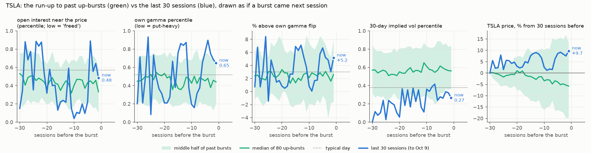
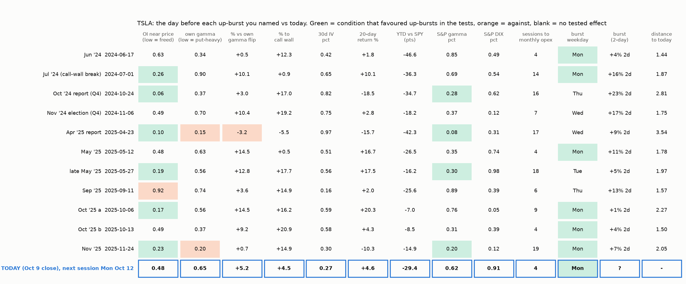

**The typical run-up** (median of 80 up-bursts since 2021):
* **Price:** a pullback, −5.8% over the 30 sessions before.
* **OI near the price:** sinks into the burst, to the 33rd percentile the day before vs 57th on a typical day.
* **Positioning:** balanced (44th percentile), about 2.6% above the own flip, with 30-day IV elevated (56th percentile).

**The last 30 sessions (to Oct 9) differ:**
* **Price:** a grind up, +9.7% over 30 sessions.
* **OI near the price:** freed through late September (4th–22nd percentile), now back to the 48th.
* **Positioning:** 65th percentile, 5.2% above the flip.
* **IV:** cheap, 27th percentile.

**The bursts named in the conversation, side by side with today.** The distance uses OI near the price, own gamma, flip distance, IV and the 20-day return.
* **Closest:** Jun '24 (distance 1.44), Oct '25 b (1.50) and Sep '25 (1.57). Today is closer to these than 78–85% of all days are. Their 2-day outcomes were +4%, +4% and +13%.
* **Allowed but not freed:** none of the three started freed, and two of them (Jun '24, Oct '25 b) were the smallest bursts on the list.
* **Shared calendar:**
  * Jun '24, May '25 and Oct '25 b all came 4 sessions before monthly opex, like Monday Oct 12.
  * Four of the named bursts were Mondays.
  * TSLA lags SPY by 29 points year to date, like the 2024 catch-up year (−35 at the Oct '24 report).
  * The opex-week effect was not significant across all bursts (§4m), so treat these as context, not signals.
* **Unusual today:** S&P DIX at the 91st percentile (only late May '25 was as high) and cheap IV (only Sep '25 and Nov '25 were as low).

**Reading.**
* **Positioning already allows an up-burst:** above the flip, not put-heavy.
* **The missing piece is the "freed" state.** The up-tilted setup turns on if OI near the price falls back into its bottom third (≤ 0.33) while TSLA holds above its flip (364).
* **The call wall at 400 (4.5% above):** the two named bursts that started within 1% of their call wall (Jul '24, May '25) broke through it.

## 4v. The Tesla moves you named, taken as given: what TSLA's own options did through each (`episodes.py`, `legs_fig.py`, `elections.py`)

**No detection rule.** The seven moves are the ones you named. Start (the base close it launched from) and top (the last high before it rolled over) were picked by hand from the daily closes:

| Move | Start | Top | Note |
|---|---|---|---|
| Oct 2021 | Fri Oct 8 | Thu Nov 4 | flat base the week before your Oct 11 week; Hertz day Oct 25 |
| Jan 2023 | Fri Jan 6 | Wed Feb 15 | off the bottom; the burst is Jan 9–27 (report Jan 25 after the close), then a slower climb |
| May 2023 | Mon May 15 | Tue Jun 20 | stair-step; ran 5 weeks, longer than the others |
| Jun–Jul 2024 | Mon Jun 24 | Wed Jul 10 | smaller week, then the big week |
| Oct–Nov 2024 | Wed Oct 23 | Mon Nov 11 | report, red week, election |
| Apr–May 2025 | Mon Apr 21 | Tue May 27 | bounce after the crash: big, small, small, big |
| Sep 2025 | Tue Sep 2 | Wed Oct 1 | smaller week (Sep 1–5), then the big week |
| **Today** | **Tue Sep 29** | ? | lowest close of the late-September base |

**Alignment.** Each move is aligned on its start and read in 5-session blocks. Values are shown as they are, with no cutoffs.

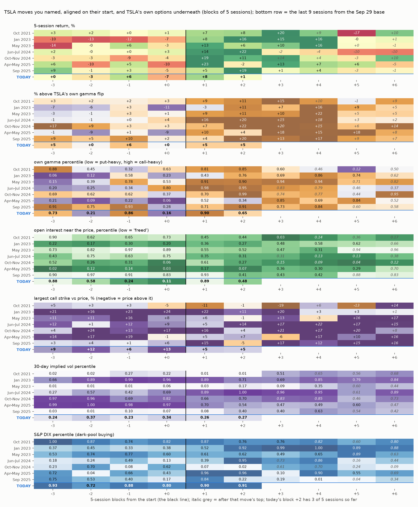
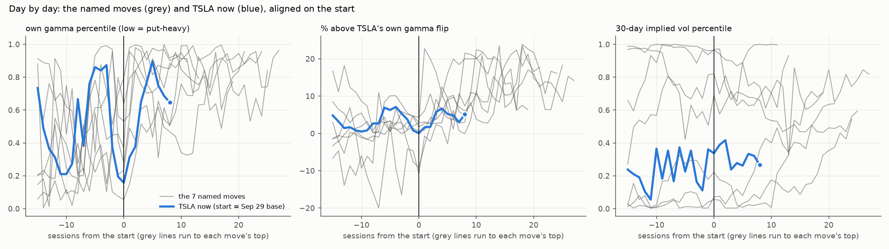
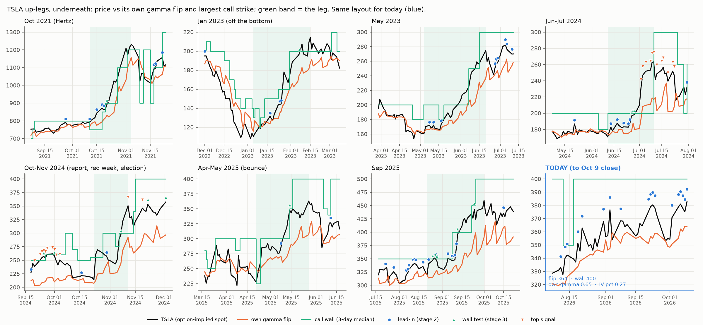
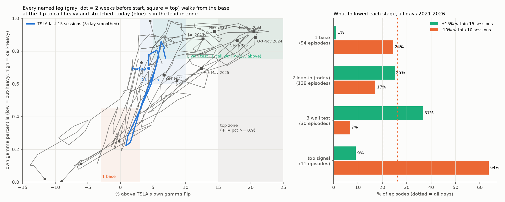

**What is common, move by move.**
* **The start sits at TSLA's own gamma flip.**
  * Five of seven started 0.7–4.3% above it: Oct 2021 +2.9, May 2023 +0.7, Jun 2024 +4.3, Oct 2024 +3.0, Sep 2025 +1.7.
  * The two bounces started about 10% below it: Jan 2023 −10.9, Apr 2025 −9.1.
* **The start is usually a dip into the flip.** The 5 sessions into the start were down in five of seven: −3.2 to −10.4%.
  * Oct 2021 and Jun 2024 instead sat in a flat base.
* **Own gamma is flushed by that dip, then snaps back.** Own-gamma percentile, the block before → the start → the first block:

| Move | Before | Start | First block |
|---|---|---|---|
| May 2023 | 0.78 | 0.53 | 0.91 |
| Oct–Nov 2024 | 0.62 | 0.37 | 0.70 |
| Sep 2025 | 0.93 | 0.28 | 0.71 |
| Jan 2023 | 0.58 | 0.23 | 0.43 |
| Apr–May 2025 | 0.22 | 0.06 | 0.52 |
| Oct 2021 (no flush) | 0.32 | 0.63 | 0.81 |
| Jun 2024 (no flush) | 0.34 | 0.80 | 0.98 |

  The dip clears call-heaviness at the flip, and the move starts as it rebuilds: the same "reset first" you described for SPY, on one stock.
* **The biggest block is usually not the first.** In five of seven a smaller block came first:
  * Oct 2021: +7, +8, then **+20**.
  * Jun 2024: +14, then **+22**.
  * Sep 2025: +5, then **+19**.
  * May 2023: +13, +6, +10, then **+16**.
  * Jan 2023: +8, then **+16**.
  * The two exceptions opened with their biggest block, on a report (Oct 2024) and on short covering (Apr 2025).
* **The largest call strike is crossed during the big blocks and then rolls higher.** Price goes above it (negative cells) in the big blocks: Oct 2021 −11/−19, May 2023 −1/−3, Apr 2025 −6, Sep 2025 −5. The wall then resets 6–17% above.
* **At the top, price is 6–22% above the flip** (most 15–22%; Oct 2021 +6%).
* **Call-heaviness peaks one to two blocks *before* the price top and is already fading at the top.**
  * Clear in four: Oct 2021 0.85 → 0.46, May 2023 0.94 → 0.71, Oct 2024 0.99 → 0.74, Jan 2023 0.86 → 0.74.
  * Mild in two: Sep 2025 0.91 → 0.84, Jun 2024 0.98 → 0.95.
  * Flat in Apr 2025: 0.85 → 0.84.
  * Price makes its last high while call positioning is already rolling over.

**Patterns within the pattern.**
* **Two implied-vol families.**
  * **Cheap-IV starts:** Oct 2021 (0.22), May 2023 (0.06), Sep 2025 (0.07). IV *rises* through the move to 0.5–0.65 near the top; spot up, vol up is the call chase.
  * **High-IV starts:** Jan 2023 (0.96), Oct 2024 (0.82), Apr 2025 (0.97), Jun 2024 (0.69). These are event or bounce moves.
    * IV stays high: Jan 2023, Oct 2024.
    * Or rises further: Jun 2024, to 1.00.
    * Or falls as the fear premium unwinds: Apr 2025, 0.97 → 0.47.
* **Two ways of topping.**
  * **Stall into a fresh pile of open interest near the price, at or right after the top:** May 2023 (near-OI percentile 0.94), Jan 2023 (0.62–0.66), Sep 2025 (0.88 the block after), Apr 2025 (0.70 the block after). Gradual.
  * **Abrupt, with little OI near the price:** Oct 2021 (0.14), Jun 2024 (0.31), Oct 2024 (0.15). Ended by a sharp down day.
* **OI near the price at the start is not common.**
  * Low: Oct 2024 0.06, Apr 2025 0.03, Jan 2023 0.20.
  * High: May 2023 0.89, Sep 2025 0.83, Jun 2024 0.75, Oct 2021 0.73.
  * The earlier "freed" result (§4t) is a tendency across all bursts, not a feature of these seven.
* **Market-wide S&P gamma and DIX are not common to the seven either.** For example, DIX was 0.13 at the Jun 2024 start and 0.82 at Oct 2021. TSLA's own positioning is what lines up.
* **Oct–Nov 2024's red week was a second flush.** Own gamma went 0.91 (Oct 25) → 0.62 (Nov 1), and the flip distance from more than +20% back to +10.7%, before the election block.
* **Apr–May 2025:** the bounce block came from deep put-heaviness (0.06, 9% below the flip). The two small blocks turned positioning balanced (0.34) and cooled IV (0.97 → 0.47). The second big block crossed the call wall (−6%).

**Today, on the same rows.**
* **Start (Sep 29):** **at the flip (+0.1%)** after a **−7.1% dip** that flushed own gamma **0.86 → 0.16**, the largest flush in the set.
* **First block:** **+7.6%**, own gamma back to **0.90**, call wall 400 about 5% above. That matches May 2023 (block +1: +13%, gamma 0.91, wall +6%) and Jun 2024 (+14%, 0.98, wall +5%).
* **Implied vol:** 0.26–0.34, between the cheap-IV and high-IV families.
* **Differences from the moves that followed:**
  * Call OI is not building: −1% in the first block and about −10% in the partial second block, vs +7–16% by the first block in five of seven.
  * Block +2 so far (3 sessions) is +0.5%.
* **Calendar:** in the step-up moves the biggest block came at blocks +2 to +4.
  * For today: block +2 ends Oct 13, block +3 holds the Oct 16 expiry, and block +4 holds the Oct 22 report reaction.

**Elections, each one as a point** (no grouping cutoffs).

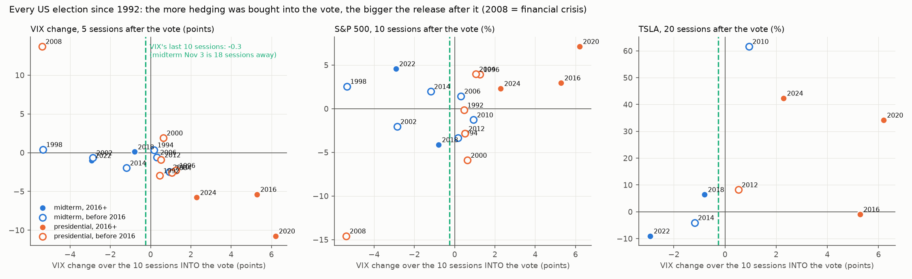

* **Across 17 elections since 1992,** the VIX change over the 10 sessions into the vote and its change over the 5 sessions after correlate at **−0.77**: the more hedging was bought into the vote, the harder VIX fell after it.
* **The S&P link is weaker:** +0.50, or +0.28 without 2008.
* **The largest run-ups are 2016, 2020 and 2024,** all presidential and in the retail-options era. They had the biggest VIX falls (−5 to −11 points) and S&P gains (+2 to +7% in 10 sessions). TSLA gained +34% (2020) and +42% (2024) in 20 sessions.
* **Midterms mostly had VIX falling into the vote** (left of zero) and small moves after.
* **The 2026 midterm:** VIX is 15.4 and −0.3 over the last 10 sessions, with the vote 18 sessions away. Whether VIX builds into it is what decides if there is anything to release.

*An earlier draft of this section found moves with a rule (≥ 25% in ≤ 20 sessions) and tested fixed stage cutoffs (`legs.py`, `leg_stages.py`). It is kept in the code for reference, but nothing above depends on it.*

## 4w. TSLA now: expiry, dark pools, and the calendar ahead (`tsla_now.py`, data to the Oct 9 close)

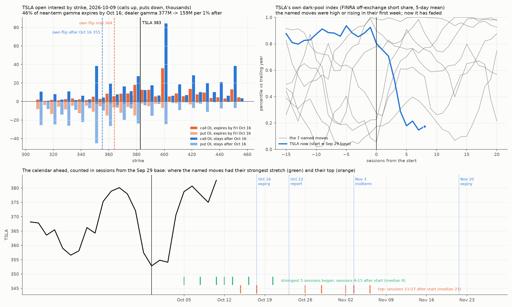

**Where it is in the pattern of the named moves.** Session 8 from the Sep 29 base.
* **Done:** base at the own flip, the flush (own gamma 0.86 → 0.16), and the snap-back block (+7.6%, own gamma 0.90).
* **Now:** block +2 has gone flat at 375–383.

**Expiry (TSLA is pre-expiration).**
* **What expires:** Friday Oct 16, together with this week's daily expiries, holds **46% of TSLA's near-term gamma**.
* **After Friday:** net dealer gamma drops from about $377M to **$159M per 1% move**, and the own flip from 364 to about **355**.
* **The pin:** the 380 strike is heavy in both calls and puts, which is the pin TSLA has been sitting on.
* **The walls:** 400 stays the largest call strike after expiry, with about half its open interest; 350 stays the largest put strike.
* **In the named moves, the expiry cycle itself does not line up:** the strongest stretch began 1–6 sessions after a monthly expiry in 2 of 7 (29% of days, p = 0.64).
* **What does line up is the report:** Tesla reports about 4 sessions after the monthly expiry. In Jan 2023, Oct 2024 and Apr 2025 that reaction was the move's biggest day, 4–5 sessions after expiry. This October has the same layout: expiry Fri Oct 16, reaction Thu Oct 22.

**Dark pools.**
* **S&P DIX** has been at the 80th–97th percentile for two weeks, a supportive market backdrop.
* **TSLA's own dark-pool index** (FINRA) fell from the 94th percentile in late September to the **17th** during the bounce.
  * In 6 of the 7 named moves it was high or rising in the first week.
  * Across all days its signal is only borderline (§4b, p ≈ 0.07–0.19), so treat this as a soft divergence.
* **The other divergence is call OI:** it is not building (about −10% in the current block) vs +7–16% by the first block in 5 of 7 moves.

**Timing, from the named moves.**
* **Strongest 5 sessions:** began 4–15 sessions after the start (median 9), i.e. by about Oct 20.
* **Tops:** came 11–27 sessions after the start (median 21), i.e. **Oct 14 – Nov 5, median about Oct 28**.
* **Price at the top:** 15–22% above the own flip in most moves, roughly 410–445 on today's flip.

**What would confirm, what would break it.**
* **Confirmation, in the direction the named moves took:**
  * call OI building again after Friday
  * TSLA's own dark-pool index turning up
  * IV rising with price
  * price crossing and holding above 400, after which the wall rolled up in the named moves
* **Break:** a close back under the flip (364 now, about 355 after Friday). In §4s that is where down-bursts doubled; the 350 put strike sits just below.
* **Midterm:** VIX is flat at 15.4, so no event premium has built for Nov 3 yet.

## 4x. MSFT continuation and the S&P Q4 window, by analogs (`outlook.py`)

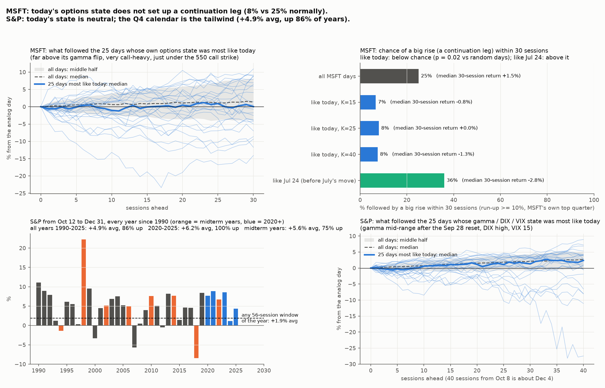

**Method.** No hand-set cutoffs; each asset is read on its own data only.
* **Analogs:** the K days most like today across several readings (z-scored), at least 10 sessions apart, excluding the last 30 sessions.
* **Luck check:** compared with 4,000 random sets of K days under the same spacing.
* **Robustness:** K = 15/25/40, and each reading dropped in turn.
* **A "big rise":** a run-up in the asset's own top quarter of days.

**MSFT** (own options state: flip distance, own gamma, OI near the price, call-wall gap, IV, 20-day return; 30 sessions ahead).
* **Days like today** (far above the flip, very call-heavy, just under 550) were followed by a big rise only **7–8%** of the time vs **25%** normally.
  * Below chance: p = 0.02 at K = 25.
  * Median 30-session return −1.3% to 0.0% vs +1.5%.
  * Every drop-one variant stays under 25% (0–20%).
* **Days like Jul 24, before the July move,** had a big rise 36% of the time.
* **Reading:** a continuation leg is not set up; the next leg needs a reset first, or a break of 550 on earnings.

**S&P** (SqueezeMetrics gamma, DIX, VIX, VIX/VIX3M, 20-day return; 40 sessions ahead).
* **Today's state is neutral:** the median 40-session return is +1.9% to +2.8% vs +2.6% for all days, and the big-rise share is 10–20% vs 25%.
* **Seasonality is the tailwind.** S&P from Oct 12 to Dec 31 since 1990:
  * **+4.9% on average** (90% CI +3.5% to +6.4%), up **86%** of years, vs +1.9% for any window of the same length.
  * 2020–2025: +6.2%, 6 of 6 up.
  * Midterm years: +5.6%, 6 of 8 up.

## 4y. The mechanics that push price, measured (`mech_book.py`, `mechanics.py`, data to the Oct 9 close)

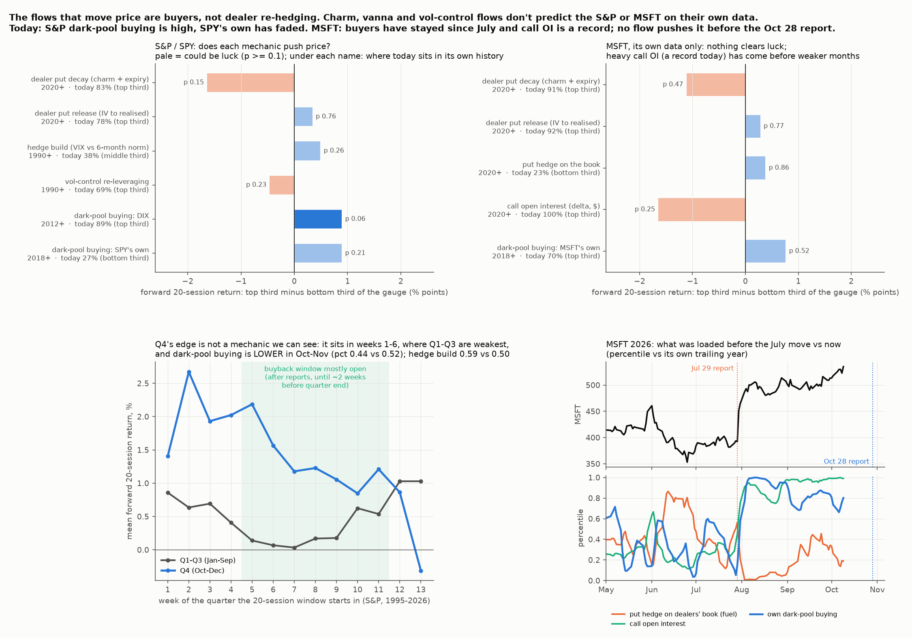

**Question.** Seasonality is a proxy. Which flows actually push the S&P and MSFT, and are they loaded now? Each asset is read on its own data only.

**The flows.** Each one can be computed before it happens.
* **Dealer put decay (charm + expiry).** Dealers short the puts customers hold are short stock as a hedge. If spot and IV stay put, they buy it back as the puts lose delta and expire. Measured as dealer delta now vs 20 sessions later, contract by contract (SPY and MSFT chains, 2020+). Expressed in days of the asset's own dollar volume.
* **Dealer put release (vanna).** The same book, if implied vol fell to the vol actually being realised (20-day).
* **Hedge build.** VIX vs its own 6-month median: how much protection has been bought (S&P, 1990+).
* **Vol-control re-leveraging.** Exposure change already scheduled for funds that size by realised vol, as old days leave the 63-day window and new days arrive at the VIX rate (S&P, 1990+).
* **Dark-pool buying.** DIX (S&P, 2012+) and each asset's own FINRA off-exchange short share (2018+).

**Test.** Forward 20-session return in each gauge's top third minus its bottom third. The null slides the gauge against returns by at least 60 sessions (keeps both series' persistence).

**Result: dealer re-hedging does not push price.**
* **S&P / SPY:**
  * Put decay: top third −1.6 points vs bottom third (p 0.15). Its sign is negative in every year 2020–26, and stays negative net of the past 20-day return.
  * Put release: +0.3 (p 0.76).
  * Hedge build: +0.5 (p 0.26).
  * Vol-control: −0.5 (p 0.23).
* **Size check:** the scheduled SPY put decay averages about half a day of SPY volume spread over 20 sessions, roughly 2–3% of daily volume.
* **MSFT:** none of its own dealer flows clears luck (p 0.47–0.86).

**What has the right sign is buying.**
* **DIX:** +0.9 points (p 0.06).
* **SPY's own dark-pool share:** +0.9 (p 0.21).
* **MSFT's own:** +0.8 (p 0.52).
* **TSLA's own (same test):** top third beats bottom third too.
* Each alone is weak; the direction agrees across all four.
* **MSFT's record call OI** has come before weaker months: −1.6 points (p 0.25). This matches 4x.

**Q4 is not a mechanic we can see.**
* **Dark-pool buying is lower in Oct–Nov:** trailing-year percentile 0.44 vs 0.52 in other windows. Adding DIX to a Q4 regression leaves the Q4 effect unchanged.
* **Hedge build doesn't matter for Q4:** Q4 was up 88% of years with a build into Oct 12 and 83% without. Correlation with the Q4 return: −0.05.
* **Not the buyback calendar:** Q1–Q3 are weakest in weeks 5–9, inside the open buyback window (weeks 5–11). Q4's strength sits in weeks 1–6.

**Now (Oct 9 close).**
* **S&P:**
  * DIX in its top third (89%): the one supportive flow.
  * SPY's own dark-pool share fell to its bottom third over the last 3 sessions (27%).
  * Hedge build in the middle (38%): there is little protection to release, and no election hedge build (4v).
  * The dealer flows are in their top third, but they carry no push.
  * **Read: mild up-lean from buyers, no mechanical accelerant.** Confirmation would be SPY's own dark-pool share rejoining DIX in the top third.
* **MSFT:**
  * The July move was not a dealer unwind. Before the Jul 29 report its own dark-pool share sat at the 8th percentile. It jumped to the top right after the gap and has stayed high (about 0.7–1.0 trailing-year percentile).
  * Buyers are still there. Call OI is a record (100%). Put hedge is in its bottom third (23%).
  * **Read: no flow is set to push a continuation leg before the Oct 28 report (after the close).** The report is the trigger; until then, heavy call OI leans against it.

## 5. MU microstructure snapshot (`options_flow.py`, `flow_intraday.py`)

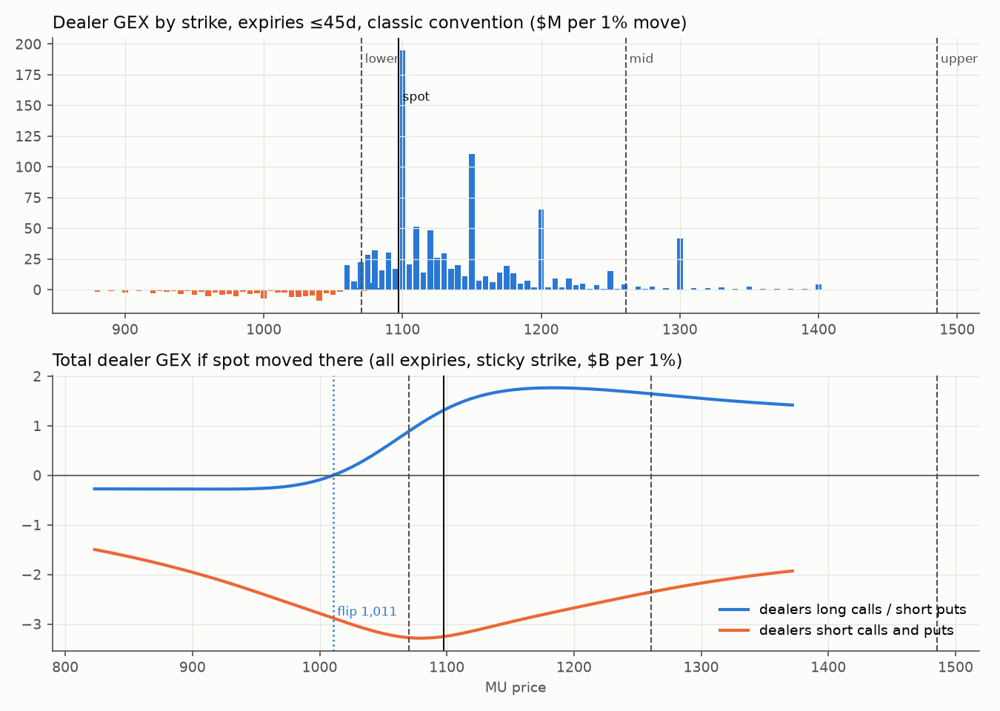

There is no free data on who is long or short each option, so dealer positioning is shown under two sign conventions.

**Classic convention (dealers long calls, short puts):**

| Item | Value |
|---|---|
| Net GEX | **+$1.31B per 1% move**, about 4.9% of MU's $26.8B average daily dollar volume, enough to dampen intraday moves |
| Gamma flip | **≈ 1,011** |
| Vanna | +$385M of dealer delta per +1 IV point |
| Charm | +$1.1B/day. Under this convention, time decay mechanically adds dealer buying into expiries while above the flip |

**If customers are net buyers of everything (likely in a parabolic name):**
net GEX is **−$3.25B per 1%**, so negative gamma everywhere. The 1,100 strike then
becomes the biggest *accelerator* rather than a pin. The truth sits between the two
conventions. Signed trade data (see §7) is what settles it.

| Level | Source |
|---|---|
| 1,485 | upper channel line |
| 1,300 | largest call OI (≤ 45 days), the call wall |
| 1,261 | mid channel line |
| 1,200 / 1,150 | next big gamma strikes |
| **1,100** | largest gamma strike, right at spot; today's 0DTE expiry |
| 1,077 | 60-session value-area high (price just accepted above it) |
| **1,070** | lower channel line (rises about 8 points/day) |
| 1,045–1,055 | max pain, 2/5/7 Oct expiries |
| **1,011** | gamma flip (classic) |
| 1,000 | large put + call open interest |
| 954 | 50-day SMA |
| 931 | 60-session point of control (POC) |

* Implied 1-standard-deviation move (straddle): ±3.4% today, ±7.9% by 9 Oct, ±15.4% by 30 Oct. ATM IV is about 53–55%, after the 30 Sep earnings.
* Put/call open-interest ratio for expiries ≤ 45 days: 1.12.

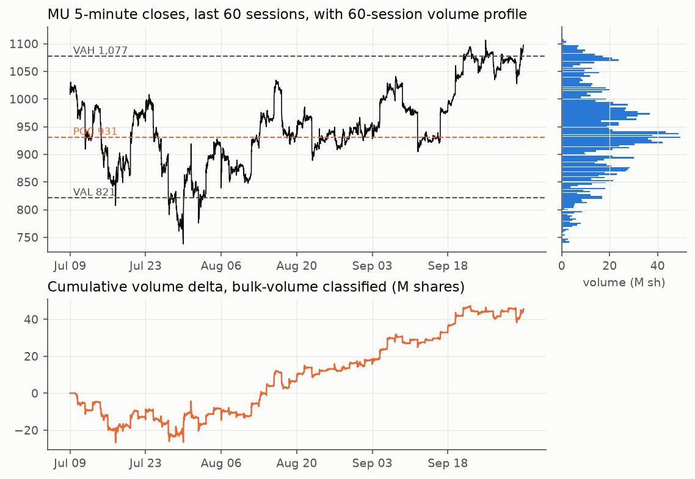

* **Order flow** (bulk-volume classification on 5-minute bars, a proxy, not real tape):
  - Cumulative volume delta is **+45.6M shares** over 60 sessions, climbing steadily from Aug 6. That is accumulation while price chopped in a 750–1,100 range.
  - The daily delta-vs-return correlation is 0.91. That is largely by construction (the classifier assigns direction from the price change), so read the level and its divergences, not the correlation.
* **Block detection:** only 3 five-minute bars cleared a 4-sigma volume threshold. Real block, sweep and iceberg detection needs tick-level prints.

### Breakout / breakdown playbook (rules derived from the above, not a forecast)

* **Up:** hold above 1,100 into the close.
  - Watch for rising IV *and* rising price. That combination means dealers are short calls, which is the negative-gamma squeeze case.
  - CVD should make new highs alongside price.
  - Targets: 1,150 → 1,200 → mid line 1,261 → call wall 1,300.
  - **Speed is required:** a channel this steep needs about +0.8%/day just to stay inside.
* **Down:** close below the lower line (1,070, rising), then below 1,011 (gamma flip).
  - Below the flip, dealer hedging amplifies moves.
  - That is the "counter-trend line" break, which the backtest says happens 62% of the time once tested, and a fast approach raises the odds.
  - Next magnets: 1,000 (put open interest), 954 (50-day SMA), 931 (POC).
* **Most likely by base rates:** time decay. Price chops between 1,045 and 1,150, pinned around 1,100 by near-dated gamma. The rising lower line runs into it within 3–9 sessions, so the *channel* ends even if the *stock* doesn't fall.

## 6. Limitations (read before trading this)

* Yahoo has no signed options trades, no historical open interest and no Level-2 data, so the GEX/vanna/charm levels are a **single-day snapshot** and the dealer sign is assumed.
* IVs were re-solved from last-trade prices and smoothed per expiry.
* Bulk-volume classification and close-location-value delta are classification proxies, not aggressor-side prints.
* The universe has survivorship bias (all are current winners), so trend persistence is probably overstated.
* Events from the 126- and 252-bar windows overlap. The confidence intervals are clustered by calendar month to absorb some of this.

## 7. Next data to get a real microstructure answer

1. **Signed options trades** (OPRA trade-level: Cboe LiveVol, ORATS, Unusual Whales/Tradier) to fix the dealer sign, plus daily open-interest history so §5 can be backtested the way §3 was.
2. **Trade and quote data** (Polygon/Databento) for real aggressor delta, block/sweep detection, and absorption at the lines. Then rerun §4 with tape features.
3. Rerun `calendar_tests` on intraday data (last-hour moves into opex) to measure pinning and vanna/charm at the resolution where they actually operate.

## Reproduce

```bash
pip install -r requirements.txt
python fetch.py MU            # MU daily/5m/1m + full option chain
python fetch.py --universe    # daily bars for the 40-name universe
python fetch.py --index       # S&P/VIX history + SqueezeMetrics GEX/DIX
python release.py             # what frees the index (section 4d)
python earnings.py            # earnings repricing vs positioning proxies (section 4e)
python strategy.py            # gamma-release rule, walk-forward (section 4f); last line = live state
python forecast.py            # gamma path analogs from today + confirmations (section 4h)
python ladder.py              # entry ladder; last lines = which rungs are ON today (section 4i)
python multiverse.py          # 216-spec multiverse vs time-shifted nulls (section 4j)
python single_name.py TSLA    # S&P gamma studies with a stock as the target (section 4k)
python burst_check.py TSLA 2024-01-01   # event-by-event bursts vs signals, false positives (4l)
python stock_now.py TSLA      # today's state + opex-timing, catch-up, grind-analog, earnings tests (4m)
python q4_forensics.py TSLA   # anatomy of Q4 catch-up legs vs controls (4n)
python tsla_eras.py           # Tesla options-regime split pre-2020 vs 2020+ (4o)
python reset.py               # topping/consolidation after legs and the gamma reset (4p)
python hd_gamma.py <sample_dir> <out.csv>   # daily gamma per underlying from HistoricalData.net-format chains (4r)
python finra_dpi.py fetch && python finra_dpi.py test TSLA MSFT MU   # per-stock dark-pool index (4r)
python earnings_implied.py    # Tesla implied vs actual earnings moves from DoltHub chains (4r)
python td_pull.py 2021-01 2026-10 TSLA SPY QQQ MSFT MU NVDA   # ThetaData chains + OI (Value tier for OI; Python 3.12 venv)
python td_gamma.py TSLA SPY   # daily gamma per stock from the ThetaData pull -> out/td_gamma_{SYM}.csv
python stock_gamma.py TSLA    # own-gamma tests: next-day move, bursts by flip side / tercile, Monday effect (4s)
python stock_gamma_fig.py TSLA   # figure for 4s
python stock_gamma_summary.py TSLA MSFT MU NVDA   # cross-stock odds ratios + figure (4s)
python burst_gamma.py TSLA    # every up-burst since 2021 vs own positioning the day before (4t)
python burst_gamma_fig.py TSLA MSFT MU NVDA      # figure for 4t
python burst_compare.py TSLA  # run-up to past up-bursts vs the last 30 sessions; named bursts vs today (4u)
python episodes.py           # the named TSLA moves as given, aligned on their start: options state block by block (4v)
python legs_fig.py            # anatomy and path figures for the named moves (4v)
python elections.py           # S&P/VIX/gamma/TSLA around every election since 1992, scatter (4v)
python tsla_now.py            # what the Oct 16 expiry removes, TSLA dark-pool index vs the named moves, calendar (4w)
python outlook.py             # MSFT and S&P analog outlook with luck and robustness checks; Q4 seasonality (4x)
python mech_book.py SPY MSFT  # dealer hedge book per day from the ThetaData chains -> out/mech_book_{SYM}.csv (4y)
python mechanics.py           # which mechanics push price (own data), today's readings, Q4 check (4y)
python data_checks_fig.py <hd_gamma.csv> <calib.csv>   # figure for 4r
python channels.py            # current MU channel
python backtest.py            # ~3-4 min on 4 cores -> out/backtest.json, out/events.csv
python report.py              # figures + out/report_numbers.json
```
